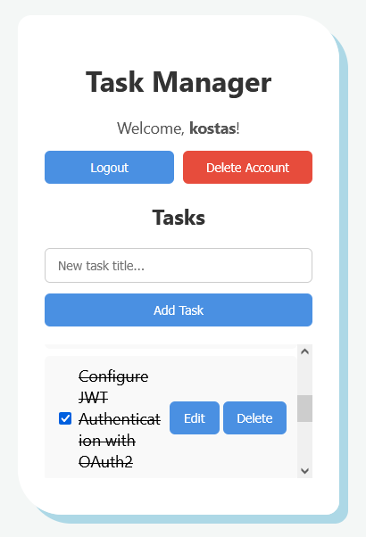
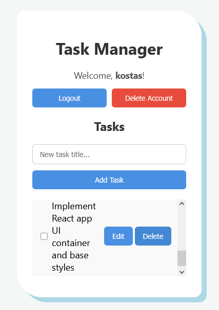
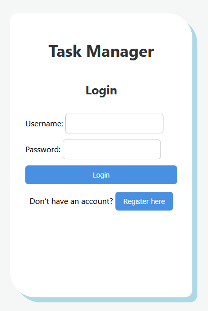
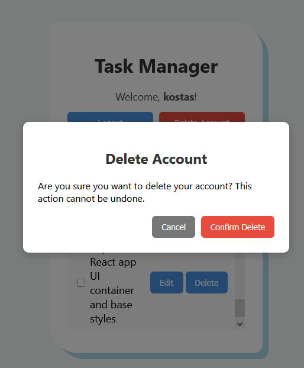
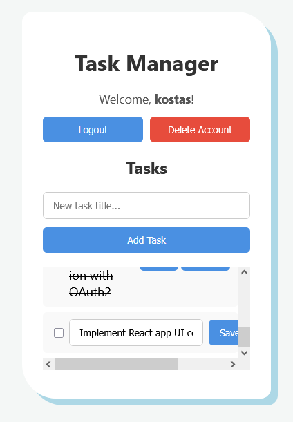

# Full-Stack Task Manager Application

A modern, responsive, full-stack Task Management application built with FastAPI (Python) on the backend and React (JavaScript) on the frontend. It features JWT-based user authentication, complete CRUD operations for tasks, inline title editing, user profile management, and a clean card-based UI.

## Getting Started

You can run the full-stack application using **Docker Compose** (recommended) or set up the backend and frontend services manually.

---

### Option 1: Running with Docker Compose (Fastest)

1. **Clone the repository:**
   ```bash
   git clone [https://github.com/kwstasZois/03-fullstack-taskmanager.git](https://github.com/kwstasZois/03-fullstack-taskmanager.git)
   
   cd task-manager
   docker compose up --build

   Frontend (React UI): http://localhost:5173
   Backend (FastAPI REST API): http://localhost:8000
   Swagger API Docs: http://localhost:8000/docs

## Local Manual Setup

### Backend Setup (FastAPI)

cd backend
python -m venv venv

# On Windows:
venv\Scripts\activate
# On macOS/Linux:
source venv/bin/activate

pip install -r requirements.txt
uvicorn main:app --reload

Backend runs at http://localhost:8000

### Frontend Setup (React)

cd frontend
npm install
npm run dev

http://localhost:5173


## Features

     User Authentication: Secure Login and Registration using JWT (JSON Web Tokens) with hashed passwords (passlib/bcrypt).

    Task CRUD Operations:

    Create: Add new tasks.

    Read: Fetch user-specific tasks from the database.

    Update: Inline editing of task titles and toggle completion status (done/undone).

    Delete: Remove tasks dynamically.

    User Session Persistence: Automatic login retention via localStorage.

    Account Management: Confirmation modal for complete account deletion (cascading removal of user and associated tasks).

    Responsive UI: Flexbox layout, auto-scrollable task list, word-wrapping for long titles, and subtle animations.


## Tech Stack

    | Domain | Technology |
    | --- | --- |
    | **Frontend** | React, Axios, CSS3, JavaScript (ES6+) |
    | **Backend** | FastAPI, SQLAlchemy, Pydantic, OAuth2 (JWT) |
    | **Database** | SQLite |
    | **DevOps** | Docker, Docker Compose |


## API Endpoints

    POST	/register	    Register a new user
    POST	/login	        Authenticate user & return JWT token	
    GET	    /tasks	        Retrieve all tasks for current user	
    POST	/tasks	        Create a new task	
    PUT	    /tasks/{id}	    Update task title or status	
    DELETE	/tasks/{id}	    Delete a specific task	
    DELETE	/users/me	    Delete current user account & data

## App Screenshots

### Main Dashboard
<table>
  <tr>
    <td align="center" width="33%">
      
    </td>
    <td align="center" width="33%">
      
    </td>
  </tr>
</table>

### Login Screen


### Delete Screen


### Edit Screen
